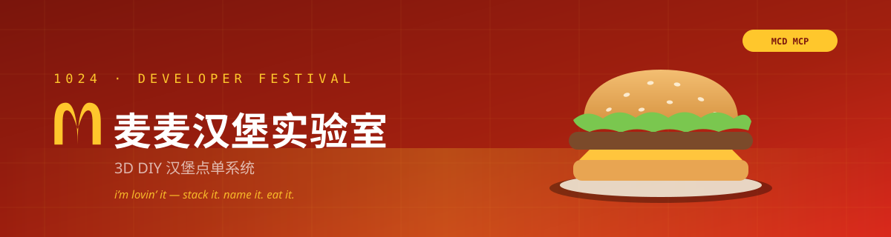
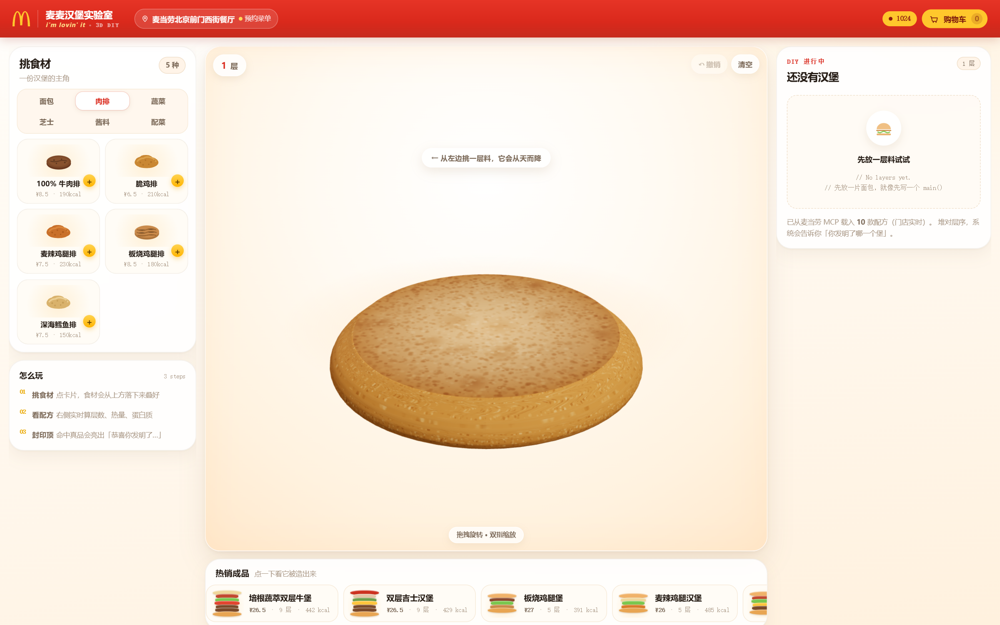
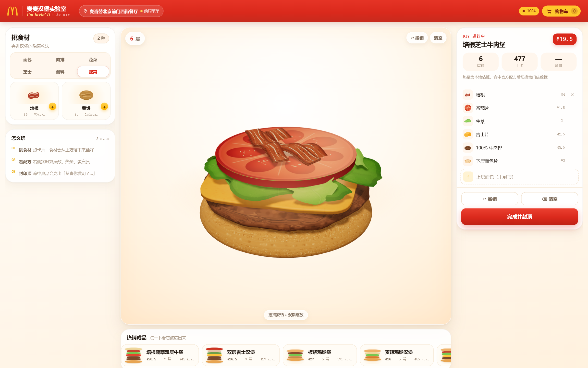
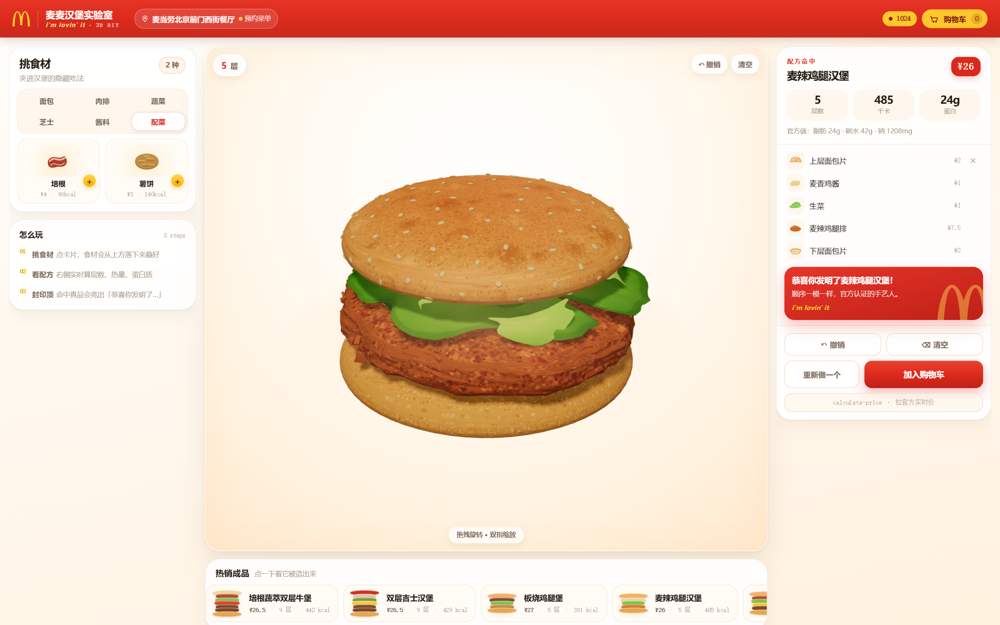
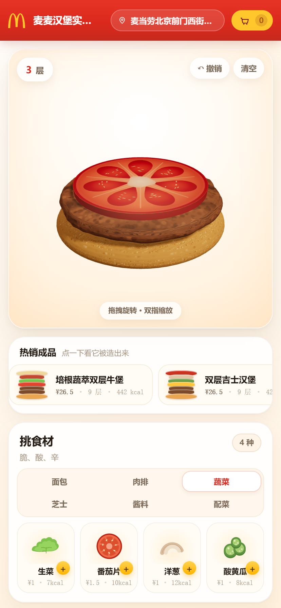

<p align="center">
  
</p>

<h1 align="center">麦麦汉堡实验室</h1>

<p align="center">
  <b>3D DIY 汉堡点单系统</b> —— 把「点单」变成「造物」<br/>
  在浏览器里一层一层堆出一座有重力的 3D 汉堡，看看你能不能复原出麦辣鸡腿堡。
</p>

<p align="center">
  
  
  
  
  
</p>

<p align="center">
  <a href="#这是什么">介绍</a> ·
  <a href="#快速开始">快速开始</a> ·
  <a href="#使用示例">使用示例</a> ·
  <a href="#mcp-整合">MCP 整合</a> ·
  <a href="./MCP_INTEGRATION.md">MCP 整合详解</a> ·
  <a href="./DESIGN.md">设计文档</a>
</p>

---

## 这是什么

麦麦汉堡实验室是一个跑在浏览器里的 **3D DIY 汉堡点单系统**。它把麦当劳 App 里那张平面的「餐品定制」页，变成一张有重力、有弹性、能 360° 转着看的 3D 工作台。

玩法只有四步：

1. 台面上先放一片下层面包。
2. 你从左侧食材区不断「＋食材」，食材从上方落下，砸在面包上，压扁、回弹、落定。
3. 堆完点「完成」，上层面包啪地扣下来。
4. 系统拿你的堆叠序列去比对麦当劳 MCP 返回的真实配方 —— 对上了，它会说「恭喜你发明了麦辣鸡腿堡！」；对不上，它就是「你的专属汉堡」，你可以给它起个名字。

菜单、配料、价格、热量**全部来自麦当劳 MCP 的实时数据**，仓库里没有写死的假菜单。

### 1024 程序员节元素

| 位置 | 元素 |
|---|---|
| Header | 红底品牌栏：金拱门 + 「麦麦汉堡实验室」，右侧一枚会呼吸的 `1024` 徽章与黄底购物车 |
| 堆叠满 10 层 | 彩蛋：台面下升起一行终端注释 `// 10 层 —— stack overflow 也不怕` |
| 完成汉堡 | 命名框默认值取自当前时间戳十六进制（`0x` 前缀） |
| 空态文案 | `No layers yet. 先放一片面包，就像先写一个 main()` |
| 加载态 | 骨架屏写成 `npm run burger` 的终端输出样式 |

---

## 截图

> 下列截图接的是**真实麦当劳 MCP**（门店：麦当劳北京前门西街餐厅），菜单、价格、热量全部来自线上。
> 拍摄时门店已打烊，所以顶栏显示「预约菜单」而不是「实时数据」—— 这是 MCP 的硬性约束
> （非营业时段只认 `reservationDate`，见下文实测），不是降级。

| 桌面端 · 空白台面 | 桌面端 · 堆叠中 |
|---|---|
|  |  |

| 配方命中 | 移动端 · 竖屏 |
|---|---|
|  |  |

---

## 目标用户

不是「想快点吃完的人」，而是这三类：

1. **麦门 DIY 玩家** —— 每次都想试试「巨无霸加一片吉士会怎样」，但 App 只有勾选框，看不到成品长什么样。3D 堆叠让「想象中的汉堡」第一次能被看见。
2. **想控热量又不想算的人** —— 一边堆一边看着卡路里往上跳，堆到 800 kcal 时数字会变红。这比事后查营养表直观得多。
3. **被点单页逼疯的程序员** —— 1024 程序员节的目标人群。他们不一定常吃麦当劳，但会为了「这个东西有点意思」点进来，然后顺手点一份。

---

## 核心功能

| 功能 | 说明 |
|---|---|
| **3D 自由堆叠** | 从下层面包开始逐层添加，带下落、压扁、回弹、落定的物理反馈 |
| **智能配方匹配** | 堆叠序列与 MCP 返回的官方配方做多重集比对，命中即点亮成就卡 |
| **实时营养与价格** | 每层热量与价格增量即时累加，超过阈值可视化告警 |
| **快速点单** | 一键载入巨无霸 / 麦辣鸡腿堡等成品堡，播放「自动组装」动画 |
| **真实下单** | 通过 `calculate-price` → `create-order` 走真实结算链路 |
| **降级可用** | MCP 不可用时自动切本地快照，界面明确标注「离线数据」 |

---

## 快速开始

### 前置条件

| 项 | 要求 |
|---|---|
| Node.js | **>= 18.18**（开发环境实测 22.22.2） |
| 麦当劳 MCP Token | 在 <https://open.mcd.cn/mcp> 用手机号登录后在「控制台 → 激活」申请 |

### 1. 克隆与安装

```bash
git clone https://github.com/RaaavenF/m-code-3d-burger.git
cd m-code-3d-burger

# 国内网络建议走镜像
npm install --registry=https://registry.npmmirror.com
```

### 2. 配置环境变量

```bash
cp .env.example .env.local
```

编辑 `.env.local`，把 `MCD_MCP_TOKEN` 换成你自己的 Token：

```dotenv
MCD_MCP_URL=https://mcp.mcd.cn
MCD_MCP_TOKEN=your_mcp_token_here
```

| 变量 | 必填 | 说明 |
|---|:---:|---|
| `MCD_MCP_URL` | 是 | 默认 `https://mcp.mcd.cn` |
| `MCD_MCP_TOKEN` | 是 | 麦当劳 MCP Token |
| `MCD_DEFAULT_STORE_CODE` | 否 | 冷启动兜底门店，留空则先查收藏餐厅 |
| `NEXT_PUBLIC_MCD_CITY` | 否 | 门店搜索城市，默认「北京」 |
| `MCD_OFFLINE` | 否 | 置 `1` 强制离线模式，用内置快照，便于无网调试 |

### 3. 启动

```bash
npm run dev
# → http://localhost:3000
```

生产构建：

```bash
npm run build && npm run start
npm run typecheck   # 仅做类型检查
```

### 没有 Token 也能跑

未配置 Token、或 MCP 不可达时，服务端会自动回落到**内置快照**（8 款经典堡 + 14 种食材），顶部显示「演示数据」黄条。除「结算下单」外的全部交互（堆叠、匹配、营养、快速点单）都可离线体验。

> 想直接看界面而不申请 Token：`MCD_OFFLINE=1 npm run dev`。

### 用 MCP 客户端直连（可选）

如果你只想在聊天客户端里试 MCP 工具而不跑前端，仓库提供了脱敏配置示例 [`mcp-config.example.json`](./mcp-config.example.json)：

```jsonc
{
  "mcpServers": {
    "mcd-mcp": {
      "type": "streamablehttp",
      "url": "${MCD_MCP_URL}",          // https://mcp.mcd.cn
      "headers": {
        "Authorization": "Bearer ${MCD_MCP_TOKEN}"
      }
    }
  }
}
```

把 `${MCD_MCP_URL}` / `${MCD_MCP_TOKEN}` 替换为你自己的值后再导入客户端。**本仓库不含任何真实 Token**，示例文件仅使用环境变量占位符。

---

## 使用示例

### 场景 A：复刻一个麦辣鸡腿堡

1. 台面默认已有一片下层面包。
2. 左侧切到「配菜」，点「＋麦辣鸡腿排」→ 肉排落下。
3. 切到「芝士」加一片吉士，再切「蔬菜」加生菜和番茄。
4. 顶部「层数」变成 6，右侧热量跳到 400 上下。
5. 点右侧「完成并封顶」→ 上层面包扣下来，系统提示 **「恭喜你发明了麦辣鸡腿堡！」**，热量自动换成官方值 **485 kcal**（来自 `list-nutrition-foods`，而非逐层加总）。

### 场景 B：自创一个官方没有的堡

1. 依次加：牛肉排 → 薯饼 → 培根 → 洋葱 → 烧烤酱。
2. 点「完成并封顶」。系统做多重集比对后判定「你的专属汉堡」，并给出最接近的官方款（编辑距离 ≤ 2 时提示「只差一样：缺 酸黄瓜」）。
3. 在命名框里给它起名（默认值是当前时间戳十六进制，如 `0x6712A4C8`）。

> ⚠️ 菜单外的自创堡**不能直接下单** —— MCP 只能下单真实存在的 SKU。系统会把它保存为「菜单外灵感」，不给会失败的结算按钮。这是平台约束，不是 bug。

### 场景 C：看清「加一片芝士」的真实代价

堆到一半时盯住右侧两个数字：**价格**和**热量**。每加一层，两个数字同时跳动；芝士 +2.5 元 / +60 kcal，培根 +4.0 元 / +90 kcal。热量超过 800 kcal 时数字转红。这就是本系统想解决的「勾选框里看不见的信息」。

---

## MCP 整合

> 完整调用流程、入参出参、配料映射表、降级策略与业务价值见 **[MCP_INTEGRATION.md](./MCP_INTEGRATION.md)**。

| MCP Tool | 本系统用它做什么 |
|---|---|
| `query-nearby-stores` | 冷启动第一步：拿到 `storeCode` / `beCode`，后续查询都依赖它 |
| `query-meals` | 拉门店实时菜单，筛汉堡类目，作为「快速点单」和配方来源 |
| `query-meal-detail` | **核心**：取默认组成 + 可特调配料清单，映射为 3D 层序列 |
| `list-nutrition-foods` | 一次拉全量营养表（实测 160 条），按产品名匹配官方热量 |
| `calculate-price` | DIY 结果映射到官方 SKU 后，带 `modification` 算真实价格 |
| `create-order` | 取餐方式选定后下单，跳转支付链接 |
| `query-store-coupons` | 结算前查当前门店可用券，透传给 `calculate-price` |
| `now-time-info` | 判断是否供餐时段，非供餐时段自动切「预约」 |

两个**必须说清楚**的接口事实（很多方案在这里写错）：

1. **没有独立的 `get_ingredients`**。配料只能从 `query-meal-detail` 的 `choice` / `modification` 结构里解析 —— 也就是 App 里那排圆形配料图标背后的数据。
2. **热量是官方值，不是估算**。`list-nutrition-foods` 无入参、一次返回全量营养表，本项目按产品名三级匹配后直接采用；只有「菜单外自创堡」才退化为逐层加总，且 UI 明确标注 `估算`。

### 真机实测（2026-10-24 00:20，真实 Token）

| 项 | 结果 |
|---|---|
| 门店解析 | `query-nearby-stores` 返回 5 家门店，含营业时间与预约时段；收藏列表为空时正确回落到城市搜索 |
| 菜单规模 | 13 个类目 / 91 个 SKU；剔除套餐后 12 款汉堡单品，详情解析出 10 款有效配方 |
| 麦辣鸡腿汉堡 | 5 层（面包·麦香鸡酱·生菜·麦辣鸡腿排·面包）· **485 kcal** · 蛋白 24 / 脂肪 24 / 碳水 42 / 钠 1208 mg · **¥26** |
| 营养表 | `list-nutrition-foods` 一次返回 160 条，数值与详情页逐字段一致 |
| 价格 | `calculate-price` 返回 2250 分（¥22.50，建外 SOHO 店），与菜单 `currentPrice: "22.5"` 一致 |
| 端到端 | 载入配方 → 封顶 → 命中「顺序一模一样」，热量自动切成官方值 |

> ⚠️ 门店打烊时 `query-meals` / `query-meal-detail` **一律返回 `600057 门店可能已关闭或不在营业时间`**，
> 必须带 `reservationDate` 才能取菜单。本项目会自动取下一个营业时段重试，并在顶栏标「预约菜单」。
> 开发这套回退时踩到的坑（MCP 把说明文字和 JSON 拼在同一段 text 里、业务失败走 HTTP 200、
> 菜单 code 与 name 分在两张表…）都写进了 [MCP_INTEGRATION.md §9.1](./MCP_INTEGRATION.md)。

---

## 技术栈

| 层 | 选型 | 为什么 |
|---|---|---|
| 框架 | Next.js 15（App Router） | 需要一层服务端保管 MCP Token，Route Handler 即可，不必单独起后端 |
| UI | React 19 + TailwindCSS 4 | 移动优先，桌面宽屏用 CSS Grid 三栏 |
| 3D | Three.js r175 + R3F 9 + Drei 10 | 声明式建场景，`useFrame` 直接驱动相机 |
| 动画 | GSAP 3 | 下落 → 压扁 → 回弹是一条时间线，keyframe + elastic 最直接 |
| MCP | `@modelcontextprotocol/sdk` | 官方 SDK，`StreamableHTTPClientTransport` 直连 `mcp.mcd.cn` |

### 架构

```text
浏览器（R3F / 3D 舞台）
   │  POST /api/mcp  { tool, args }        ← 只传工具名和参数，永不接触 Token
   ▼
Next.js Route Handler（Node runtime）
   │  MCP Client + StreamableHTTPClientTransport
   │  Authorization: Bearer ${MCD_MCP_TOKEN}   ← Token 只存在于服务端环境变量
   ▼
https://mcp.mcd.cn
   │
   ├── query-nearby-stores   → 门店上下文
   ├── query-meals           → 菜单
   ├── query-meal-detail     → 配方 + 可特调配料
   ├── list-nutrition-foods  → 官方营养
   ├── calculate-price       → 真实价格
   └── create-order          → 下单
```

---

## 目录结构

```text
src/
├── app/
│   ├── api/mcp/route.ts        MCP 代理（工具白名单 + Token 注入）
│   ├── icon.svg                站点图标（金拱门）
│   ├── layout.tsx
│   └── page.tsx                三栏主界面
├── components/
│   ├── brand/                  GoldenArches 品牌标识
│   ├── providers/              MCPProvider / OrderContext
│   ├── layout/Header.tsx
│   ├── panels/                 IngredientPanel / RecipePanel / QuickOrderRail
│   └── stage/                  CanvasStage / BurgerStack / IngredientLayer / CameraRig
│                               geometry.ts（程序化几何） / textures.ts（程序化贴图）
├── lib/
│   ├── mcp/                    client / mappers / cache / seed
│   ├── ingredients.ts          食材静态表（厚度、价格、热量、几何形态）
│   ├── stack.ts                堆叠锚点与总高度计算
│   ├── match.ts                配方匹配算法
│   └── nutrition.ts            官方营养表解析与三级名称匹配
└── types/burger.ts             领域模型
```

---

## 关键实现速览

<details>
<summary><b>1. 堆叠锚点：每层只知道自己的厚度和咬合量</b></summary>

```ts
baseY[i] = cursor
cursor  += thickness[i] - sink[i]
```

`baseY` 就是这一层的落点。改食材顺序时整条链自动重算，不需要手工维护高度。

</details>

<details>
<summary><b>2. 下落 + 压扁回弹：只动 position.y 与 scale</b></summary>

```ts
tl.fromTo(g.position, { y: 3.2 }, { y: 0, duration: 0.42, ease: 'power2.in' })
  .to(g.scale, { x: 1.08, y: 0.82, z: 1.08, duration: 0.09 })   // 触地压扁
  .to(g.scale, { x: 0.97, y: 1.06, z: 0.97, duration: 0.14 })   // 回弹过冲
  .to(g.scale, { x: 1, y: 1, z: 1, duration: 0.22, ease: 'elastic.out(1, 0.4)' })
```

几何体在局部坐标里以**底面为原点**建模，所以 `scale.y` 压缩时底部不会陷进上一层。只动画 `position.y` 与 `scale`，走 GPU 合成。

</details>

<details>
<summary><b>3. 配方匹配：不能去重，否则双层堡会变成单层堡</b></summary>

双层脆鸡堡与单层麦香鸡的唯一区别就是那块脆鸡出现了两次，去重会把两个堡判成同一个。

```ts
const sameParts  = sameMultiset(userIds, recipe.ingredientIds);   // 顺序无关、重数敏感
const exactOrder = userIds.join('>') === recipe.ingredientIds.join('>');
```

- `exactOrder` → 「完美复刻」，播放成就动画
- `sameParts && !exactOrder` → 「顺序不同，但配料齐了」
- 都不满足 → 算编辑距离，≤ 2 时提示「只差一样：缺 酸黄瓜」

</details>

<details>
<summary><b>4. 相机自适应：只改焦点高度和距离，不动用户已调好的方位角</b></summary>

```ts
const focusY = totalHeight * 0.58;
const dist   = THREE.MathUtils.clamp(5.9 + totalHeight * 0.82, 5.9, 14);
camera.position.copy(controls.target).add(offset.normalize().multiplyScalar(dist));
```

俯仰夹在 25°–36° 观测仰角：更俯一点汉堡会被压成圆饼，更平一点最底层会被压成一条线。这组数字是拿截图反复比出来的。

</details>

<details>
<summary><b>5. 食材细节：全部程序化生成，零贴图文件、零 GLB</b></summary>

| 食材 | 几何 | 质感 |
|---|---|---|
| 面包（下） | 轮廓收成平顶，一张 0.843 半径圆片把平顶**盖满** | 瓤是暖米色 + 看得见的细孔（3600 粒气孔），外皮深一档 |
| 面包（上） | 圆顶轮廓，最大半径 0.925、厚度 0.40；96 粒芝麻沿外法线贴面 | 2.3 : 1 的高径比，肩部弧线才立得住 |
| 牛肉排 | 手压轮廓 + 揉皱 + 3 道焦带画进贴图 | 中褐带红调，1500 颗 2–5px 粗颗粒（1px 密点是砂纸） |
| 脆鸡排 | 轮廓抖动 0.044 / 频率 12，正弦 + 两层环面噪声 | 44 块边角块骑在轮廓线上、54 片顶面翻壳 |
| 薯饼 | 齿边轮廓 + 4 层薯丝共 1160 根 | 深金底 + 30 块焦斑，薯丝逐根换色 |
| 生菜 | **三片错开的叶盘**：各自偏心、各自转向、z 向拍扁；褶线相位随半径偏移（`a + t·0.85`） | 同心圆盘叠不出「几片」，外轮廓永远是个圆 |
| 番茄片 | 一张**画出来的横切面**：512² 贴图 + 侧壁圆片 | 7 个透镜形心室、隔膜、水滴形籽、果皮圈 |
| 芝士片 | **有厚度**的方片：1.62 见方、超椭圆（n=6）削角、顶面 + 底面 + 侧壁 | 角半径 1.02 压过面包（0.925），成品里四角会探出——这是它唯一的辨识信号 |
| 洋葱 | **7 块有厚度的环形扇区**，两端收薄到 45%，段间留缝 | 顶点色内缘乳白 → 外缘暖褐；同心层理画进贴图 |

</details>

---

## 已知限制

如实列出，避免误导：

1. **3D 食材是程序化低模几何，不是 GLB**。官方未开放食材模型资产，程序化建模可零资产启动；同时保留 `<ModelSlot>` 适配层，后续拿到 GLB 直接替换。
2. **热量分两级**。官方成品堡用 `list-nutrition-foods` 的真实值（如麦辣鸡腿汉堡 485 kcal、巨无霸 513 kcal），界面标「官方值」；「菜单外自创堡」逐层加总，界面标「估算」。
3. **DIY 汉堡不能凭空下单**。MCP 只能下单真实存在的 SKU，所以「完成」时先把 DIY 结果映射到最接近的官方堡 + `modification` 增删。
4. **需要门店上下文**。所有查询都要 `storeCode`，无定位权限时退到 `MCD_DEFAULT_STORE_CODE` 或手动选店。
5. **手机号登录链路未接入**。MCP 的会员态接口（领券、查积分）需要 `Authorization` 之外的业务登录态，本项目未实现，因此不提供「帮用户领券」功能。
6. **门店打烊后展示的是「预约时段」的菜单**。MCP 在非营业时段只认 `reservationDate`，本项目自动取下一个营业时段重试，顶栏据此显示「预约菜单」并注明具体时段 —— 数据本身仍是真实的，只是视角是下一档。
7. **`create-order` 未实测**。真实下单会产生订单，开发期只验证到 `calculate-price`。

---

## 安全与隐私

| 项 | 做法 |
|---|---|
| Token 位置 | 仅服务端环境变量；客户端只能 `POST /api/mcp { tool, args }`，bundle 内不存在 Token 字符串 |
| 工具白名单 | `/api/mcp` 只放行 8 个白名单工具，其余 403，防止被当成通用 MCP 代理刷接口 |
| 凭证不入库 | `.env.local` 在 `.gitignore` 中；`mcp-config.example.json` 只含 `${MCD_MCP_TOKEN}` 占位符 |
| 不留用户资产 | 不读取、不存储用户手机号、地址、券；账户类操作一律交给麦当劳官方链路 |
| 依赖来源 | 仅 npm 官方镜像的公开包，无 CDN 脚本、无外链注入 |

---

## 参赛提交物

本项目参加 **麦当劳程序员创意开发大赛**，仓库按活动要求包含以下文件：

| 序号 | 文件 | 状态 | 说明 |
|:---:|---|:---:|---|
| 1 | [`README.md`](./README.md) | ✅ | 项目介绍、安装方法、使用示例、目标用户 |
| 2 | [`CONTEST_DECLARATION.md`](./CONTEST_DECLARATION.md) | ✅ | 参赛声明（使用官方原文，内容未改动） |
| 3 | [`MCP_INTEGRATION.md`](./MCP_INTEGRATION.md) | ✅ | 实际使用的 MCP Server / Tool / 调用流程 / 业务价值 |
| 4 | [`mcp-config.example.json`](./mcp-config.example.json) | ✅ | 脱敏配置，仅含环境变量占位符 |
| 5 | [`workbuddy.md`](./workbuddy.md) | ✅ | WorkBuddy 对话上下文（用于 WorkBuddy 专项奖励核验） |
| 6 | `src/` 源代码 | ✅ | 完整可运行工程（Next.js 15） |
| — | [`DESIGN.md`](./DESIGN.md) | 附加 | 视觉与交互设计文档：色板、字体刻度、断点、组件树、动效参数、无障碍检查清单 |

---

## 赛事信息

- 活动：麦当劳 1024 程序员创意开发大赛
- 活动时间：2026 年 10 月 9 日 10:30 — 10 月 25 日 23:59（北京时间）
- 活动仓库：[M-China-Official/mcd-developer-innovation-challenge](https://github.com/M-China-Official/mcd-developer-innovation-challenge)
- 麦当劳 MCP 使用指南：[M-China/mcd-mcp-server](https://github.com/M-China/mcd-mcp-server)
- 本项目使用 **腾讯 WorkBuddy** 辅助开发，对话上下文见 [`workbuddy.md`](./workbuddy.md)

---

## 免责声明

本项目为参赛作品，由参赛者独立开发，**非麦当劳官方产品**，与麦当劳无隶属关系。

- 餐品信息、价格、供应状态以麦当劳官方渠道的实时结果为准；
- 本系统展示的热量数据中，标注「估算」的部分为逐层加总结果，**不构成营养、医疗或健康建议**；
- 「金拱门」图形商标归麦当劳所有，本项目仅在品牌化演示中引用，不使用其作为自身标识。

## License

[MIT](./LICENSE)
